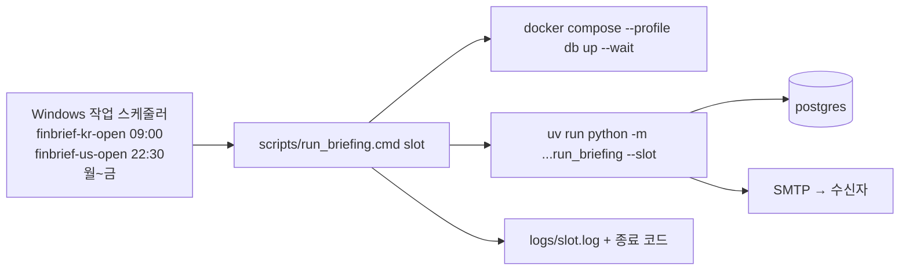

# 🗺️ 계획: 로컬 스케줄 — delivery-channels Task 8 재정의

## 목표
평일 09:00 KST 와 22:30 KST 에 사람이 아무것도 치지 않아도 브리핑 메일이 온다. PC 가 그 시각에 잠들어 있었으면 깨어난 뒤 바로 온다. 안 왔으면 `logs/<slot>.log` 와 작업 스케줄러의 마지막 실행 결과에 이유가 있다. 코드는 바뀌지 않는다 — 바뀌는 것은 "누가 부르는가"다.

이 계획은 **delivery-channels 의 Task 8 을 다시 정의**한다. 새 주제의 tasks.json 을 만들지 않고 `delivery-channels.tasks.json` 의 Task 8 을 고쳐 쓴다 (terraform 전제 삭제). 상태 정본은 그 파일이다.

## 구조


## 변경 대상
| 경로 | 신규/수정 | 역할 |
|---|---|---|
| `scripts/run_briefing.cmd` | 신규 | 런처. 저장소로 `cd` → Docker 엔진 대기 → DB 기동 → 작업 실행 → 로그 → **작업의 종료 코드를 그대로 반환** |
| `scripts/register_tasks.ps1` | 신규 | 두 항목을 멱등으로 등록. `-Unregister` 로 해제. 실패한 `finbrief-us-open-once` 제거 |
| `.gitignore` | 수정 | `logs/` |
| `README.md` | 수정 | "운영" 절: 등록·해제, 로그 위치, 수동 실행, 결과 코드 읽는 법, 앱 비밀번호 교체 |
| `docs/04_tasks/delivery-channels.tasks.json` | 수정 | Task 8 재정의(todo), Task 10 추가 |
| `C:\Users\HH_PC\AppData\Local\finbrief\` | 삭제 | 저장소 밖 런처 사본(문서 없음, 2026-10-08) |

## Task 목록

### Task 8 — 로컬 스케줄: 런처, 작업 스케줄러 등록, 운영 절차
- **목적**: 위 "목표".
- **선행**: Task 7 (done)
- **먼저 쓸 테스트**: 없음(스크립트·등록). 대신 완료 판정에 실제 등록과 수동 1회 실행을 넣는다.
- **DoD**: 두 항목이 등록돼 있고 설정이 분석대로다(WakeToRun·StartWhenAvailable·30분 제한·IgnoreNew·배터리에서도 실행) / 등록 직후 `Start-ScheduledTask finbrief-kr-open` 수동 실행이 `logs/kr_open.log` 에 `=== exit 0` 을 남긴다(오늘 이미 받았으므로 발송 없이 끝까지 간다) / `finbrief-us-open-once` 와 AppData 사본이 없다 / README 에 운영 절차가 있다 / 린트·타입·테스트 통과(코드 변경이 없으므로 그대로 통과해야 한다).
- **검증**: `powershell -NoProfile -Command "if ((Get-ScheduledTask -TaskName finbrief-kr-open,finbrief-us-open -ErrorAction Stop | Measure-Object).Count -ne 2) { exit 1 }" && findstr /c:"=== exit 0" logs\kr_open.log && uv run ruff check . && uv run mypy && uv run pytest`
- **예상 규모**: cmd ~40줄, ps1 ~60줄, README ~40줄

### Task 10 — 이미 전원이 받은 날은 수집을 건너뛴다 (선택)
- **목적**: 작업이 같은 날 두 번 불려도 Marketaux 등 외부 호출을 쓰지 않는다. [[2026-10-08_run-briefing]] 의 발견 이슈. 스케줄 결정의 선행 조건은 아니지만, 수동 재실행과 `StartWhenAvailable` 재시도가 공짜가 된다.
- **선행**: Task 7
- **먼저 쓸 테스트**: `아직 못 받은 수신자가 없으면 수집하지 않고 skipped 만 보고한다`, `한 명이라도 pending/failed 면 수집한다`
- **DoD**: `run()` 이 수집 전에 발송 기록을 본다 / 기존 테스트 통과
- **검증**: `uv run pytest tests/jobs tests/deliver && uv run ruff check . && uv run mypy && uv run pytest`

## 의존 그래프
```
Task 7 (done) → Task 8
             ↘ Task 10 (선택, 독립)
```

## PoC 로 먼저 확인할 것 (가장 앞 Task 로)
- [x] 런처가 작업 스케줄러에서 시작되는가 — Task 8 의 수동 1회 실행이 그 확인이다. 별도 Task 로 떼지 않는다.

## 롤백
`scripts\register_tasks.ps1 -Unregister` 한 줄. 코드가 바뀌지 않으므로 그 외 되돌릴 것이 없다. 수동 실행(`uv run python -m finbrief_analyzer.jobs.run_briefing --slot …`)은 그대로 쓸 수 있다.

## 관련
- 분석: [[2026-10-12_local-schedule]]
- 원래 플랜(Task 8 terraform 판): [[2026-10-07_delivery-channels]]
