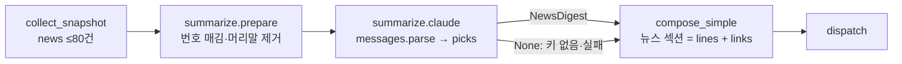

# 🗺️ 계획: LLM 뉴스 선별·요약 단계

## 목표
브리핑 메일의 "뉴스" 섹션이 최신순 10건 나열 대신 **골라낸 N건 + 건별 한국어 한 줄 요약 + 원문 링크**로 온다. 요약은 수집 뒤·작성 전의 새 단계 `summarize` 가 Claude API 로 만든다. 키가 없거나 호출이 실패하면 지금 메일(v0 목록)이 그대로 간다. 모델·N·effort·줄 길이는 첫 Task(PoC)에서 실측으로 정한다.

## 구조

- `summarize` 는 `MarketSnapshot` 을 읽기만 한다. 수집 모델·렌더러는 바뀌지 않는다.
- 모델은 **번호**로 고른다. URL·제목은 코드가 입력에서 되찾는다.

## 변경 대상
| 경로 | 신규/수정 | 역할 |
|---|---|---|
| `docs/01_research/2026-10-12_news-summary-poc.md` | 신규 | Task 1 결과: 모델·effort 비교, 토큰·비용, 기준 ①~⑤ 눈검사, 확정값(모델·N·effort·줄 길이) |
| `pyproject.toml`, `uv.lock` | 수정 | `anthropic` 의존성(1.13.x) |
| `src/finbrief_analyzer/core/config.py` | 수정 | `anthropic_api_key: SecretStr \| None`, `summary_model`, `summary_picks`, `summary_timeout_seconds`, `summary_effort`; 빈 값→None 검증기에 키 추가 |
| `.env.example`, `README.md` | 수정 | 키·설정 설명, "키가 없으면 지금처럼 목록" |
| `src/finbrief_analyzer/summarize/__init__.py` | 신규 | 패키지 |
| `src/finbrief_analyzer/summarize/models.py` | 신규 | `DigestItem(news: NewsItem, line: str)`, `NewsDigest(items, model, usage)` |
| `src/finbrief_analyzer/summarize/prepare.py` | 신규 | 입력 전처리: 번호 매김, 연합 머리말 제거, 항목 텍스트(출처·제목·리드), 입력 텍스트 조립 |
| `src/finbrief_analyzer/summarize/ports.py` | 신규 | `Summarizer` 프로토콜: `(news, slot) -> NewsDigest \| None` |
| `src/finbrief_analyzer/summarize/claude.py` | 신규 | Claude 어댑터: 시스템 프롬프트 상수, Pydantic 출력 스키마(`picks[{index, line}]`), `client.messages.parse`, 결과 검증, 오류 유형별 처리(경고 + None) |
| `src/finbrief_analyzer/compose/simple.py` | 수정 | `compose_simple(snapshot, date, digest=None)`; digest 가 있으면 뉴스 섹션 = 요약 줄(출처 표기) + 원문 링크, 없으면 v0. 요약이 켜져 있었는데 실패한 경우의 설명 한 줄 |
| `src/finbrief_analyzer/jobs/run_briefing.py` | 수정 | `JobDeps.summarize: Summarizer \| None`; `open_deps` 가 키가 있을 때만 어댑터를 만든다; `run()` 순서 collect → summarize → compose; 요약 결과·토큰을 요약 로그에 |
| `tests/summarize/` | 신규 | prepare·claude 어댑터·모델 테스트 (가짜 client) |
| `tests/compose/test_simple.py`, `tests/jobs/test_run_briefing.py`, `tests/test_config.py` | 수정 | digest 유무 렌더링, 대체 경로, 설정 |

## Task 목록

### Task 1 — PoC: 실제 하루치 뉴스로 모델·effort 비교
- **목적**: 분석이 PoC 로 미룬 값을 정한다 — 모델(Opus/Sonnet/Haiku 5.5), effort(medium/low), N, 줄 길이 상한. 제목+리드만으로 "입력에 없는 사실 0, 단순 축약 아님"이 되는지 눈으로 본다.
- **선행**: 없음. Anthropic API 키(사용자가 발급·충전). 스크래치 스크립트는 커밋하지 않는다.
- **먼저 쓸 테스트**: 없음(탐색). 대신 답할 것: ① 실제 kr_open 수집 결과(≤80건)를 JSON 으로 저장 ② 같은 입력·같은 프롬프트로 4가지(Opus medium, Opus low, Sonnet, Haiku) 호출 ③ `usage` 토큰·비용·소요 시간 ④ 기준 ①~⑤(사실성·축약·중복·한국어·길이) 표 ⑤ 구조화 출력이 번호 선택 스키마를 지키는가 ⑥ `count_tokens` 로 한국어 토큰/글자 실측.
- **DoD**: PoC 노트에 위 6개 답과 **확정값(모델·effort·N·줄 길이)** 이 있다 / 프롬프트 초안이 노트에 있다 / 키·출력 원문에 비밀값 없음.
- **검증**: `python -c "import pathlib;t=pathlib.Path('docs/01_research/2026-10-12_news-summary-poc.md').read_text(encoding='utf-8');assert all(k in t for k in ['claude-opus-5-5','claude-haiku-5-5','usage','확정'])"`
- **예상 규모**: 스크립트 ~80줄(미커밋), 노트 1장. 소요는 모름 — API 계정 준비에 달림.

### Task 2 — 의존성과 설정
- **목적**: `anthropic` 을 들이고 설정 자리를 만든다. 키가 없으면 전부 비활성.
- **선행**: Task 1 (기본값 확정)
- **먼저 쓸 테스트**: `anthropic_api_key 가 비어 있으면 None 이다`, `summary_picks 는 1 이상 20 이하다`, `summary_model 기본값은 PoC 확정 모델이다`.
- **DoD**: `uv add anthropic` 반영, `Settings` 필드 5개와 검증기, `.env.example` 갱신 / `make check` 통과 / 기존 테스트 변경 없음.
- **검증**: `uv run pytest tests/test_config.py && uv run ruff check . && uv run mypy && uv run pytest`
- **예상 규모**: ~40줄

### Task 3 — 요약 모델과 입력 전처리
- **목적**: LLM 에 보낼 텍스트와 받을 결과의 자료형. 외부 호출 없이 전부 순수 함수.
- **선행**: Task 2
- **먼저 쓸 테스트**: `연합 머리말 "(서울=연합뉴스) 홍길동 기자 =" 은 리드에서 제거된다`, `항목은 1부터 번호가 붙고 번호로 원 항목을 되찾는다`, `리드가 None 인 항목은 제목만 들어간다`, `입력 텍스트에 URL 은 들어가지 않는다`(토큰 절약·날조 방지), `80건을 넘지 않는다`.
- **DoD**: `summarize/models.py`, `prepare.py`, `ports.py` / 테스트 통과.
- **검증**: `uv run pytest tests/summarize && uv run ruff check . && uv run mypy && uv run pytest`
- **예상 규모**: ~120줄 + 테스트 ~100줄

### Task 4 — Claude 어댑터
- **목적**: 한 번의 `messages.parse` 호출로 `picks` 를 받고 검증해 `NewsDigest` 를 만든다. 어떤 실패도 예외로 새지 않고 `None` + 경고.
- **선행**: Task 3
- **먼저 쓸 테스트** (가짜 client, `messages.parse` 만 흉내): `정상 응답은 번호 순서대로 DigestItem 이 된다`, `범위 밖·중복 번호와 빈 줄은 버린다`, `남는 것이 없으면 None`, `N 을 넘는 선택은 앞 N 개만`, `RateLimitError·APIConnectionError·APITimeoutError 는 None 과 경고`, `stop_reason=refusal 은 None`, `경고 로그에 키가 없다`, `요청에 model·max_tokens·effort·timeout 이 설정값으로 들어간다`.
- **DoD**: `summarize/claude.py` / 시스템 프롬프트는 코드 상수(PoC 초안) / 테스트 통과 / 함수 30줄 이하.
- **검증**: `uv run pytest tests/summarize && uv run ruff check . && uv run mypy && uv run pytest`
- **예상 규모**: ~150줄 + 테스트 ~150줄

### Task 5 — 작성기: 요약이 있으면 쓴다
- **목적**: `compose_simple` 이 `digest` 를 받아 뉴스 섹션을 요약 줄 + 링크로 만든다. 없으면 지금과 같다.
- **선행**: Task 3
- **먼저 쓸 테스트**: `digest 가 있으면 뉴스 섹션 lines 는 "요약 (출처)" 꼴이고 links 는 같은 순서의 원문이다`, `digest 가 None 이면 v0 와 같다(기존 테스트 유지)`, `요약이 켜져 있었는데 비었으면 설명 한 줄이 들어간다`, `뉴스 섹션은 여전히 required 가 아니다`.
- **DoD**: `compose/simple.py` 수정, 기존 compose 테스트 전부 통과 / 렌더러 변경 없음.
- **검증**: `uv run pytest tests/compose && uv run ruff check . && uv run mypy && uv run pytest`
- **예상 규모**: ~40줄 + 테스트 ~60줄

### Task 6 — 작업에 연결: collect → summarize → compose
- **목적**: 실제 작업이 요약을 부르고, 실패하면 v0 로 간다. 로그 한 줄에 선택 건수·토큰이 남는다.
- **선행**: Task 4, Task 5
- **먼저 쓸 테스트**: `summarize 가 None 이면 요약 없이 v0 메일이 간다`, `summarize 가 digest 를 주면 메일 본문에 요약 줄이 있다`, `summarize 가 None 을 돌려주면(실패) 메일은 v0 로 가고 경고가 남는다`, `summarize 는 수신자가 기다릴 때만 불린다`(Task 10 의 수집 생략과 같은 자리), `open_deps 는 키가 없으면 summarize=None`.
- **DoD**: `JobDeps.summarize`, `open_deps` 배선, `run()` 순서 / 요약 로그 `summary: picks=N input_tokens=.. output_tokens=..` / 전체 테스트 통과.
- **검증**: `uv run pytest tests/jobs && uv run ruff check . && uv run mypy && uv run pytest`
- **예상 규모**: ~60줄 + 테스트 ~80줄

### Task 7 — 실전 확인과 운영 문서
- **목적**: 실제 메일에서 요약이 보이고, 키를 비우면 이전 메일로 돌아가는 것을 확인한다.
- **선행**: Task 6
- **먼저 쓸 테스트**: 없음. 손으로: ① `.env` 에 키 넣고 `scripts\run_briefing.cmd` 로 1회 실행(발송) → 메일의 뉴스 섹션 확인, 로그의 토큰 ② 키 비우고 수동 실행(이미 받은 날이라 수집 생략됨 → 다른 슬롯 또는 테스트 수신자로) ③ 로그에 비밀값 없음.
- **DoD**: README "설정" 절에 키·모델·N 설명과 "키가 없으면 목록" / 구현 노트에 실제 메일 발췌와 토큰·비용 / `.env.example` 반영.
- **검증**: `findstr /c:"summary: picks=" logs\kr_open.log && uv run ruff check . && uv run mypy && uv run pytest`
- **예상 규모**: 문서 ~40줄

## 의존 그래프
```
Task 1 (PoC) → Task 2 → Task 3 → Task 4 ─┐
                               ↘ Task 5 ─┴→ Task 6 → Task 7
```

## PoC 로 먼저 확인할 것 (가장 앞 Task 로)
- [ ] 제목+리드만으로 "입력에 없는 사실 0, 단순 축약 아님"이 되는가 → Task 1
- [ ] 모델별 품질 차이가 비용 차이를 정당화하는가 → Task 1
- [ ] 구조화 출력이 번호 선택 스키마를 안정적으로 지키는가 → Task 1
- [ ] 한국어 토큰/글자(신형 토크나이저) → Task 1 의 `count_tokens`

## 롤백
`.env` 에서 `APP_ANTHROPIC_API_KEY` 를 비우면 다음 실행부터 v0 목록이다(코드 배포 없음). 코드를 되돌리려면 `summarize/` 패키지와 `compose_simple` 의 `digest` 인자, `JobDeps.summarize` 를 지운다. DB·스키마 변경이 없어 그 외 되돌릴 것이 없다.

## 열어둔 질문
- API 계정·결제는 사용자가 한다. Task 1 전에 키가 필요하다.
- Task 7 의 ② "키를 비운 실행" 확인은 같은 날 같은 슬롯이 이미 발송됐으면 수집을 건너뛰어 볼 수 없다. 다음 날 아침 자동 실행 전에 키를 비워 두는 식의 일정 조정이 필요할 수 있다 — Task 단계에서 정한다.

## 관련
- 분석: [[2026-10-12_news-summary]]
- 리서치: [[2026-10-12_news-summary]] (01_research)
